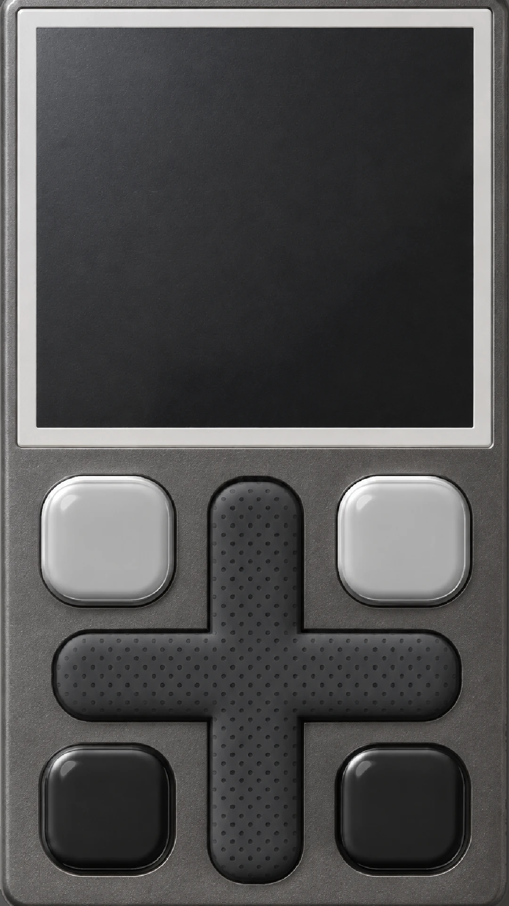

# komemu

スマホ向けの、ハード風エミュレーターUIです。筐体の画像に 180×164px の画面と操作部を重ねて、ブラウザだけで動きます。

いまあるのは「ハード」の部分だけで、動かすソフトはまだありません。画面には入力確認用のデモが映ります。



## 動かし方

ビルドは不要です。フォルダを静的サーバーで配信して開きます。

```bash
python3 -m http.server 8765
```

- PC: http://localhost:8765
- スマホ: 同じ Wi‑Fi につないで `http://<PCのIPアドレス>:8765`

スマホでは「ホーム画面に追加」するとアドレスバーなしで開けます。

## 操作

| 操作部 | 動作 | PCのキー |
| --- | --- | --- |
| 十字パッドをタップ・長押し | 上下左右の入力 | 矢印キー |
| 十字パッドをなぞる | スクロール（離すと慣性で流れる） | パッド上でホイール |
| 上段のボタン（左・右） | `tl` / `tr` | Q / W |
| 下段のボタン（左・右） | `bl` / `br` | A / S |

押すと操作音が鳴ります（ボタンは「カチッ」、十字パッドは鈍い音）。なぞっている間は鳴りません。Android では短く振動します。

### デモ画面での割り当て

- 十字: キャラ移動 ／ なぞる: マップをスクロール
- 左上: 配色切替 ／ 右上: キャラ位置へ戻る
- 左下: 目印を置く ／ 右下: 目印を消す

## ファイル

| ファイル | 内容 |
| --- | --- |
| `index.html` / `style.css` | 筐体のレイアウト |
| `emu.js` | 画面と入力、操作音 |
| `demo.js` | 入力確認用のデモ。ソフトを作るときはここを差し替える |
| `skin.webp` | 筐体の画像（1080×1920） |
| `無題71*.PNG` | 筐体の元画像（画面オフ版と、画面位置を青で示した版） |

## ソフト側から使う

`emu.js` が `window.Emu` を用意します。

```js
const { ctx, WIDTH, HEIGHT, state } = Emu;   // 180×164 の Canvas 2D コンテキスト

// 押下状態: state.up / down / left / right / tl / tr / bl / br
Emu.on('button', (name, down) => { /* 押した・離した */ });

// 十字パッドをなぞった量（画面ピクセル単位）。info.inertia は慣性分なら true
Emu.on('scroll', (dx, dy, info) => { /* ... */ });
```

## 調整するところ

いずれも `emu.js` の先頭付近にあります。

- `RECT`: 筐体画像上の画面・十字パッド・ボタンの位置
- `VOLUME`: 操作音全体の音量（0〜1）
- `DRAG_THRESHOLD`: タップとスクロールを分ける移動量
- `FRICTION`: 慣性スクロールの減衰
